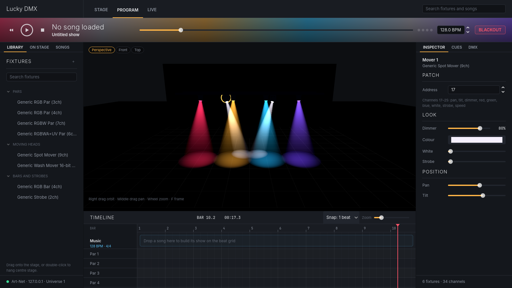
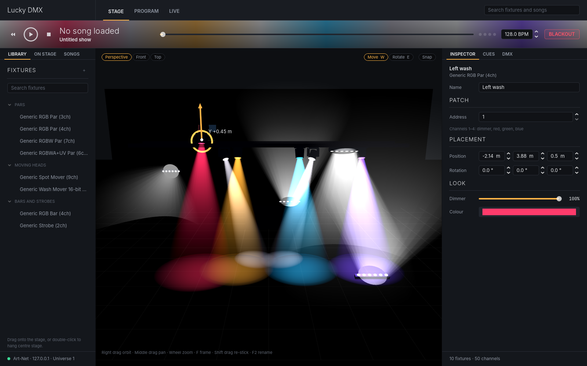
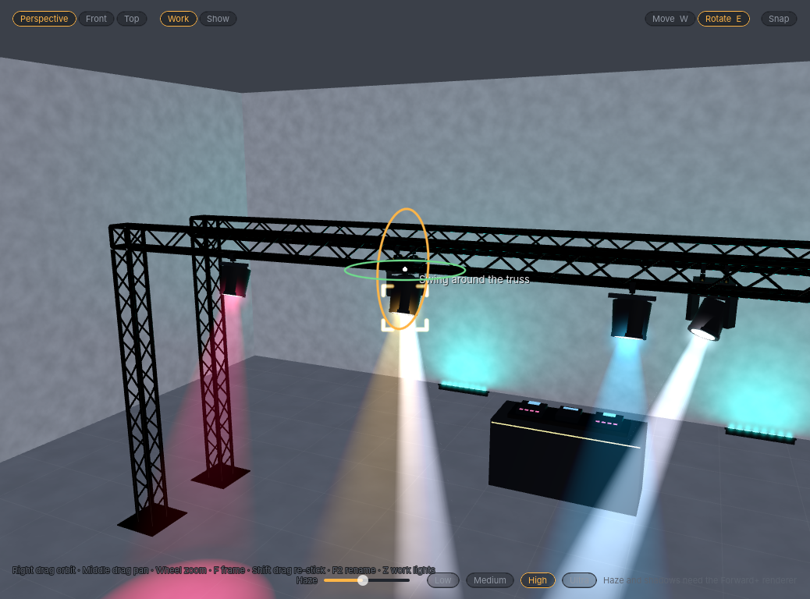
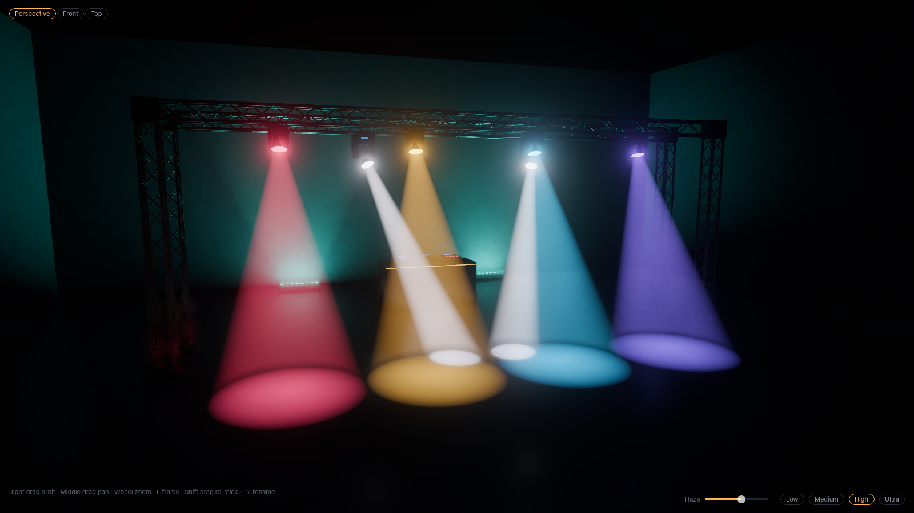
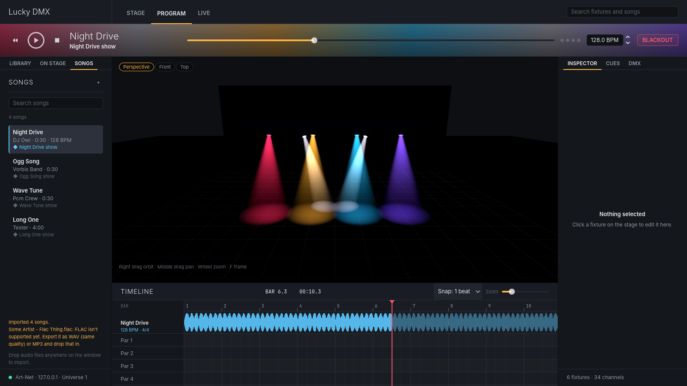
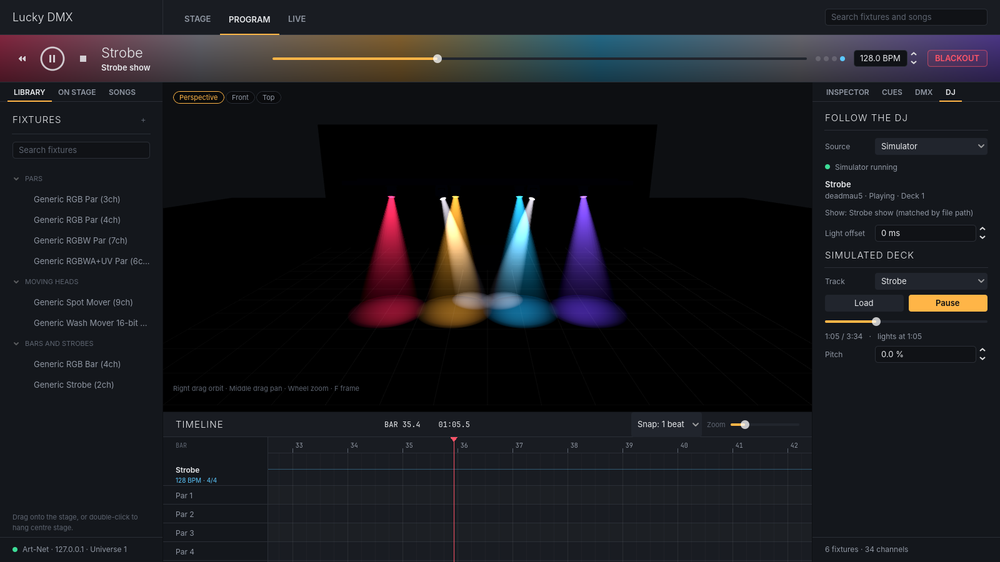

# Precision: fixture control from Godot 4

Open `project.godot` in Godot 4.7+ and press Play. The editor UI opens (see below).
The original one-light test is still at `demo/demo.tscn` (open it and press F6).
Demo controls: **SPACE** = GO next cue, **B** = back, **P** = play/stop timeline, **ESC** = blackout.

## The editor UI (ui/)
| Area | What it's for |
|---|---|
| Header | Workspaces: **Stage** (place and patch), **Program** (build a song's show), **Live** (run the night). Keys 1/2/3. |
| Now playing band | Transport, tempo, beat dots, **Blackout** (Esc). Its background blends the rig's live colours. |
| Left dock | **Library** (drag a fixture onto the stage, or double-click), **On stage** (patch list), **Songs** (your music, see below). |
| Centre | 3D stage. Hold right mouse to fly like the Godot editor (drag to look, WASD move, Q/E down/up, Shift faster, wheel sets speed), Alt drag orbit, middle drag pan, wheel zoom, F frame, left click select, drag on empty space to box select several, Delete to remove. See **Placing fixtures** below. |
| Bottom | Beat-grid timeline: the song's waveform, a lane per fixture, red playhead (Space plays the song). Clips come next. |
| Right dock | **Inspector** (patch, colour, dimmer, pan/tilt), **Cues** (Record / GO), **DMX** (live 512-channel monitor). |

Every part is a scene you can open and edit in the Godot editor; scripts only add behaviour
and find their nodes by unique name (`%Name`), so you can move and restyle nodes freely as
long as the unique names stay.

| Scene | What's in it |
|---|---|
| `ui/main/main_window.tscn` | The window layout, with each panel below instanced into it. |
| `ui/main/studio_context.tscn` | Shared state: Art-Net output (set the target IP here), universe, rig, cues, song library, music player, DJ sync. |
| `ui/panels/*.tscn` | One scene per panel (library, on stage, songs, inspector, cues, DMX, DJ, timeline, now playing) and `song_row.tscn`. |
| `ui/stage/stage_view.tscn` | The 3D stage: camera, environment, floor grid, overlay buttons. |
| `ui/stage/stage_room.tscn` | The club room. `StageSurface` boxes (floor, walls, booth) are what fixtures stick to; its `Set` node is the truss rig, built from structure pieces. |
| `structure/pieces/*.tscn` | Structure pieces: base plate, truss 0.5 / 1 / 2 / 3 m, corner box. Any scene added here shows up in the library. |
| `ui/stage/fixtures/*.tscn` | The 3D model of each fixture type (par, spot mover, wash mover, bar, strobe), with its truss clamps as `MountPoint` nodes. |
| `ui/stage/fixtures/parts/omega_bracket.tscn` | The omega bracket a moving head hangs from; each mover clamp has one under it. |

### Placing fixtures
- **Drop from the library** near a truss and the fixture clamps onto the nearest bar (any of the four, on
  any piece) by its own clamps, hanging away from the truss and facing the audience. Drop it on the back wall, the floor or the DJ booth and it
  sticks flush to that surface with its beam pointing into the room (an amber ring shows where it lands).
  Hold **Alt** while dropping to skip snapping and just hang it above that spot.
- **Drag a fixture** to slide it along the tube or surface it's on; the spot you grabbed stays under the cursor.
  **Shift + drag** re-sticks it onto whatever surface is under the cursor.
- **Gizmo** (Stage workspace): **W** move (arrows = one axis, squares = a plane), **E** rotate (rings).
  Turn on **Snap**, or hold **Ctrl** while dragging, for 0.25 m / 15° steps.
  The inspector's **Placement** fields take exact numbers.
- **Rotate rings follow the mounting**: a fixture only turns the ways it really could where it is.
  Hung on a truss it **swings around the tube**; with a single clamp (par, strobe) it can also
  **spin under the clamp**, while two clamps (light bar, moving head) lock that. Standing on the floor,
  a wall or the booth it only **spins on the spot**. Placed freely (Alt) it turns about any axis.
  Hover a ring to see what it does. Motorised pan and tilt stay in the inspector's **Aim** section.
  New fixtures get this from their MountPoints; override it per scene on the root node
  (**Rotating on stage**), or untick **Swivel** on a MountPoint.
- **Undo**: **Ctrl+Z** undoes, **Ctrl+R** redoes (**Ctrl+Shift+Z** and **Ctrl+Y** redo too;
  Cmd on a Mac). One history covers the whole app: placing, moving, turning, snapping and
  deleting fixtures and truss pieces, renaming and re-patching, inspector edits (dimmer, colour,
  white, strobe, pan, tilt, typed values) and recording cues. A slider drag or a colour-picker
  session is one step; quick wheel or arrow nudges merge. While you type in a text field,
  Ctrl+Z undoes your typing instead. (Run from the Godot editor, the running window gets
  Ctrl+R; the editor's own shortcuts only apply while the editor has focus.)
- **Rename**: F2, double-click the fixture, or type in the inspector's **Name** field.
  Double-click a row in **On stage** to rename it in place. An empty name goes back to "Par 3".
  Your name is display only; cues still find the fixture by its node name.

### Building a set (structure)
The **Structure** group in the library holds the truss pieces. Drag one onto the stage:
- **Base plates** go on the floor only (Snap / Ctrl gives 0.25 m steps).
- **Truss** snaps onto the free connector nearest the cursor: the top of a base plate, the end of another
  truss, or a face of a corner box.
- **Corner boxes** snap onto a truss end; their other faces let the next truss go up, down or turn 90°.

In the Stage workspace click a piece to select it, drag it to snap it somewhere else, **R** to give it a
quarter turn about the joint it hangs from, **Delete** to remove it. Fixtures don't follow a piece you
move yet, and the set isn't saved with the show yet (nothing is, so far).

### Selecting several things
Drag on empty space to draw a box: every fixture whose middle is inside it is selected (in the Stage
workspace, truss pieces and base plates too). **Shift** + drag adds to what is already selected, a click
on empty space or **Esc** clears it. With several things selected, **Delete** removes them all (one
**Ctrl+Z** brings them all back), and dragging one of them slides the whole group across the floor
plan, keeping each one's height. A box has to start on empty space; starting on a fixture or truss
drags that instead.

Each piece is a scene with the `StructurePiece` script and three kinds of child nodes:
- `TrussConnector` (a Marker3D): a face that joins another piece. +Y points out of the face, +Z is
  "outward x up". Its **Accepts** flags say which kinds of piece may join there.
  An orange arrow shows which way it faces: always in the editor, and in the app on the free
  connectors a piece could join while you place one.
- `TrussTube`: a bar fixtures can clamp onto, from the node along its +X for `length`. `hang_side`
  says which side fixtures hang on. Drawn as an orange line in the editor. Tubes that line up end to
  end across joined trusses count as one run, so fixtures slide across joints.
- `TrussMesh`: draws the lattice (straight or corner) from its settings; not saved into the scene.

### Truss clamps
Each fixture scene has one `MountPoint` node per clamp the real fixture uses: one on a par's or
strobe's bracket, two on a moving head (one per omega bracket), one at each end of a light bar.
A `MountPoint`'s origin is the centre of the tube it grips and the tube runs along its X axis, so to
change where a fixture hangs, move its clamps in the fixture scene. Keep all of a fixture's clamps on
one line along its X axis. The clamp model is drawn from the node's settings (`drop`, `width`,
`screw_side`); anything placed under a `MountPoint` (like the omega bracket) shows only while the
fixture hangs on a truss, and is hidden once it stands on the floor or a wall or is moved off the tube.
A hung fixture slides along its tube only until its outermost clamp reaches the end, so a long bar with
a clamp at each end stops sooner than a par with one clamp in the middle.

Shared materials: `ui/stage/materials/black_metal.tres` (truss, brackets) and `fixture_plastic.tres`
(fixture bodies).

### How the stage looks
Best in **Godot 4.7+ with the Forward+ renderer**. Visual only: none of this changes DMX.
- **Moving heads** are real `SpotLight3D`s with a round iris (spot movers) or a soft
  wash ("Wash" profiles), and cast shadows from Medium quality up.
- **Pars** are `SpotLight3D` washes; **light bars and strobes** are `AreaLight3D`s the size
  of their LED face (Godot 4.7+; older versions fall back to a row of spot lights).
- Every fixture also draws a soft beam cone, a glowing lens and a halo, and follows
  colour, dimmer, strobe, pan and tilt.
- **Work / Show** (top left of the stage, or press **Z**): like a 3D app's solid vs
  rendered view. **Work** turns the house lights on: an evenly lit grey room with a key
  and fill light, so you can see the truss and fixture bodies while you build and aim.
  Fixtures still light up and draw (softer) beams. **Show** is the dark club room where
  only the fixtures and the haze light the stage.
- **Haze** slider (bottom right of the stage): how much smoke is in the room. Beams and
  volumetric light shafts read more in haze.
- **Low / Medium / High / Ultra**: Low is beam cones only; Medium adds volumetric haze,
  mover shadows and ambient occlusion; High adds shadows on every light and floor
  reflections; Ultra adds finer haze, soft shadows and light bounce.
  Shading, haze and quality are saved per computer in `user://stage_look.cfg`.
- The floor grid only shows in the **Stage** workspace.

Code: `ui/stage/stage_look.gd` (environment and quality), `stage_fixture_3d.gd` (fixtures),
`stage_set.gd` (truss, walls, booth gear), `beam.gdshader`, `lens_glow.gdshader`.
`godot --path . --script res://ui/stage/stage_shot_cli.gd -- out.png [haze] [quality] [yaw pitch distance] [work|show]`
renders the stage alone for checking the look.

The UI sends Art-Net to 127.0.0.1 by default so nothing hits the network until you
change `artnet_target` on the `Studio` node in `ui/main/main_window.tscn`.

### Theme
All colours, sizes and fonts live in `ui/theme/ui_palette.gd`. `ui/theme/lucky_theme.gd`
builds a Theme from them, baked to `ui/theme/lucky_dark.tres` (set as the project theme).
After changing the palette, open `ui/theme/bake_theme.gd` and use File > Run, or run
`godot --headless --script res://ui/theme/bake_theme_cli.gd`.
Fonts are looked up on the system (Inter, then Open Sans, Segoe UI, ...); install
[Inter](https://rsms.me/inter/) for the intended look.

## Songs (music/)
Drag MP3, WAV or OGG files (or a whole folder) anywhere onto the window, or press **+** in
the Songs tab. Each file is copied into the app's library folder, its title / artist / BPM
tags are read, and its waveform is worked out in the background. Click a song to put it on
the timeline: play and the lights follow the music's own clock. Change the BPM and the song
remembers it. Right-click a song to rename its show or remove it.

FLAC isn't supported yet (Godot can't load it at runtime); export it as WAV or MP3.

| Script | What it does |
|---|---|
| `Song` | One track: tags, duration, BPM, the library's copy of the file, and its linked show. |
| `SongLibrary` | Imports, removes and searches songs; saves `songs.json`. Lives under `user://library` (on Windows `%APPDATA%\Godot\app_userdata\Precision\library`). |
| `AudioMetadata` | Reads ID3 (MP3), Vorbis comments (OGG) and RIFF INFO (WAV) tags. Falls back to "Artist - Title" file names. |
| `AudioDecoder` | Loads files as AudioStreams and computes waveform peaks (cached as `.peaks` files). |

Each song has a `show_id` / `show_name`. `StudioContext.show_started(song)` fires when a song
starts playing; the show player will hook in there once shows are saved as files
(`SongLibrary.show_path_for(song)` is where they'll go).

## Following the DJ (djsync/)
The **DJ** tab on the right makes the lights follow whoever is DJing: when they start a new
track, that song's show loads; pause, play, scrubbing and pitch changes move the timeline
with them. Works today with **VirtualDJ** and with a built-in **Simulator** deck for trying
it without any DJ software. See [docs/dj_sync.md](docs/dj_sync.md) for how it works, which
DJ setups can be supported and in what order.

## Hooking up your light
1. Open `demo/demo.tscn` and select **Par1**. In the Inspector, open its **Profile** and set
   **Channels** to your fixture's channel list, in order, as shown in its manual for the DMX
   mode it's set to. Set **Start Address** to the address shown on the fixture.
2. Select **ArtNet** and set **Target Ip** to your Art-Net node's IP. Broadcast
   (255.255.255.255) works for a first test.
3. No hardware yet? Point it at 127.0.0.1 and use a visualizer such as QLC+ (free)
   with an Art-Net input to check the values.

## Pieces (addons/lucky_dmx)
| Script | What it does |
|---|---|
| `ArtNetOutput` | Sends ArtDMX packets over UDP. Subclass `DMXOutput` for sACN or a USB interface. |
| `DMXUniverse` | 512-channel buffer, sent at 40 Hz. |
| `FixtureProfile` | Resource listing a fixture's channels. Save one `.tres` per fixture model. |
| `DMXFixture` | A light. `dimmer`, `color`, `pan`, `tilt` etc. are ordinary properties. Use `set_raw()` for anything else. |
| `CueStack` + `LightCue` | Console-style cue list with fade times. Use `record_cue()` to snapshot the current look. |

## Using the timeline in the editor
Because fixture settings are ordinary properties, an **AnimationPlayer is your timeline**.
Add a DMXFixture node, then keyframe its color and dimmer with the key icon in the
Inspector. Turn on `send_in_editor` on the DMXUniverse and the real light follows as you
scrub. A Call Method track can fire `CueStack.go_to()` at set times.
